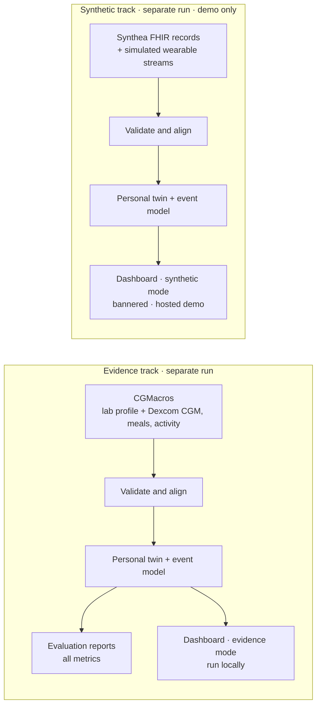
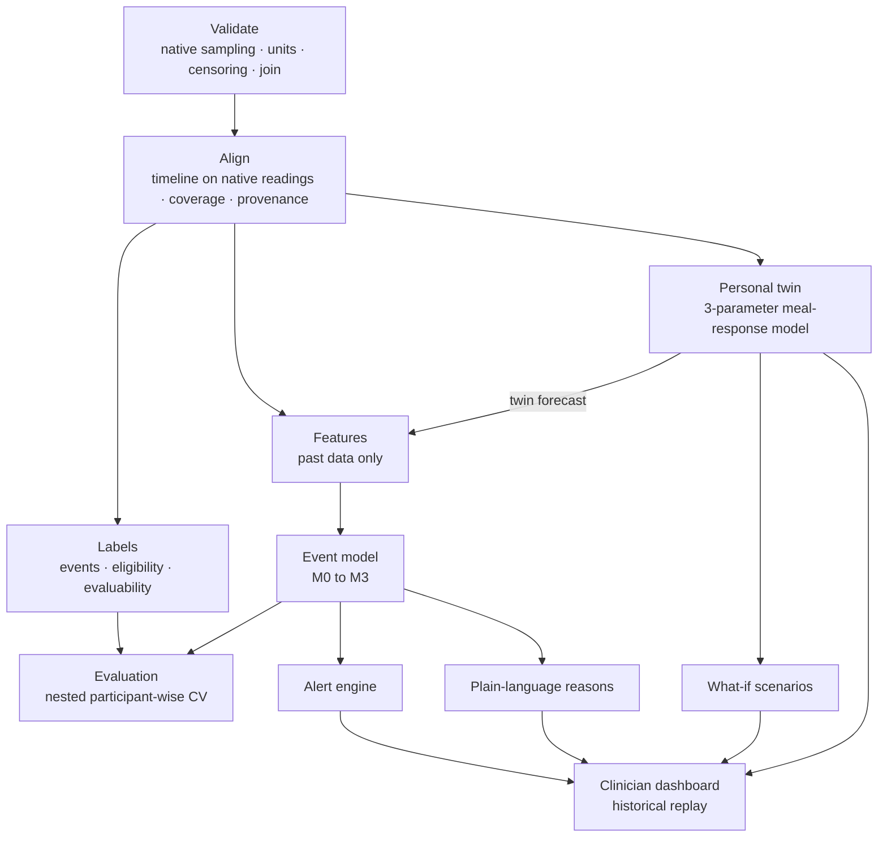

# GlucoTwin

**A personalised glucose digital twin that forecasts post-meal glucose excursions up to 2 hours ahead — a clinician-facing research prototype for India's Type 2 diabetes use case**

Team **kabhinav24** · Happiest Health Digital Twin Challenge · Reimagining and Reforming Healthcare in India Summit 2026, Bengaluru

> **Status (20 Oct 2026): implemented and tested on synthetic data.** The evidence-track evaluation on CGMacros runs locally and has not been run yet, so no accuracy results are reported. See the [status table](#3-status).

| | |
|---|---|
| **Condition** | Type 2 diabetes and prediabetes |
| **Event predicted** | Glucose above 180 mg/dL for at least 15 minutes, starting within the next 120 minutes |
| **Evidence track** | Real, anonymised CGMacros data: lab profile, Dexcom CGM (5-minute), meals and activity for the same participants. All reported results come from here. |
| **Synthetic track** | Synthea v3.4.0 simulated EHRs (FHIR) + simulated wearable streams with Indian meal patterns. Demonstrates the brief's simulated-EHR fusion; never used for accuracy claims. |
| **Models** | Trend baseline (M0), dynamic (M1), fused (M2) and twin-enhanced (M3) models. All four are reported; the dashboard model is chosen by inner cross-validation. |
| **Clinician UI** | Streamlit dashboard: historical replay, risk and forecast, data quality, reasons, what-if scenarios |
| **Licences** | Code: Apache-2.0 · CGMacros data: CC BY-NC-SA 4.0 (not redistributed) |
| **Demo video** | Planned — link added after recording |

---

## Contents

1. [Team details](#1-team-details)
2. [Problem statement and healthcare use case](#2-problem-statement-and-healthcare-use-case)
3. [Status](#3-status)
4. [Solution overview](#4-solution-overview)
5. [Architecture](#5-architecture)
6. [Prediction task](#6-prediction-task)
7. [Data, provenance and compliance](#7-data-provenance-and-compliance)
8. [Technical stack and model details](#8-technical-stack-and-model-details)
9. [Results](#9-results)
10. [Clinician dashboard](#10-clinician-dashboard)
11. [Challenge coverage](#11-challenge-coverage)
12. [How to run](#12-how-to-run)
13. [Repository structure](#13-repository-structure)
14. [Video demonstration](#14-video-demonstration)
15. [Architecture diagram and presentation](#15-architecture-diagram-and-presentation)
16. [Licences](#16-licences)
17. [Safety, privacy and limitations](#17-safety-privacy-and-limitations)
18. [References](#18-references)

---

## 1. Team details

**Team name:** kabhinav24
**Repository folder name:** `kabhinav24_[College Name]`

| # | Name | Role in the project | College / Incubator | Programme & year | Email |
|---|---|---|---|---|---|
| 1 | [Name] — **Team leader** | [Role] | [College, City] | [Programme, Year] | [email] |
| 2 | [Name] | [Role] | [College, City] | [Programme, Year] | [email] |
| 3 | [Name] | [Role] | [College, City] | [Programme, Year] | [email] |
| 4 | [Name] | [Role] | [College, City] | [Programme, Year] | [email] |

**College / incubator information:** [College name(s), city] · [Incubator name, if any]
**Point of contact:** [Team leader name], [email]

---

## 2. Problem statement and healthcare use case

### The problem

India has **101 million adults with diabetes and 136 million with prediabetes** (ICMR-INDIAB, 2023). Combined control of blood sugar, blood pressure and cholesterol is achieved in **under 7%** of people with self-reported diabetes.

Meals are a large daily driver: Indians get about **62% of their calories from carbohydrates** (ICMR-INDIAB, 2025). Post-meal glucose excursions are common. Between clinic visits, doctors see almost none of them.

### Intended use

GlucoTwin is a **clinician-facing research prototype**. For a patient who has worn a CGM and a fitness band, it:

1. combines the patient's lab profile with their glucose, meal and activity history into a personal model;
2. estimates the risk that glucose will rise above 180 mg/dL and stay there for at least 15 minutes within the next 2 hours;
3. shows the forecast, the main factors behind the risk, and the quality of the data it rests on;
4. lets the clinician compare a few hypothetical scenarios — such as a smaller carbohydrate portion — side by side with the baseline, as simulated estimates.

**About the forecast.** It comes from a simple meal-response model. It is not a physiological simulation of insulin, digestion or medication.

**About the threshold.** 180 mg/dL is the upper bound of the standard time-in-range target for CGM data. Here it defines the prediction task. It is not an emergency or treatment trigger.

**Not intended for:** diagnosis, treatment or dosing decisions, emergencies, or use without clinician oversight.

---

## 3. Status

| Component | Status | Evidence |
|---|---|---|
| Repository foundation — packaging, pinned dependencies, CI workflow, repository safety check | Implemented | `.github/workflows/ci.yml`, `scripts/check_repo_safety.py`. Lint, tests, smoke run and safety check pass locally on Python 3.11 and 3.13; the first GitHub Actions run happens after upload. |
| Data validation — native sensor sampling, units, censoring, join | Implemented; tested on CGMacros-shaped fixtures. The first check on the real files happens on the first evidence run. | `tests/test_validation.py` |
| Interval-aware alignment and coverage | Implemented | `tests/test_alignment.py` |
| Labels — prediction eligibility and label evaluability | Implemented | `tests/test_labels.py` |
| Event-to-alert matching | Implemented | `tests/test_matching.py` |
| Leakage checks | Implemented | `tests/test_no_leakage.py` |
| M0–M3 models, nested cross-validation, alert engine, reports | Implemented; run end to end on the synthetic demo only | `tests/test_pipeline.py`, `reports/synthetic/` |
| Personal twin and personalisation experiment | Implemented | `tests/test_twin.py`, `reports/synthetic/results.md` |
| **Evidence-track evaluation on CGMacros** | **Planned** — run locally after downloading the data | `reports/results.md` (generated by that run) |
| Synthetic track — Synthea FHIR ingestion and simulated streams | Implemented; Synthea v3.4.0 run committed | `data/synthetic/`, `tests/test_fusion.py` |
| Dashboard — replay, data quality, reasons, what-if | Implemented | `tests/test_replay.py`, `tests/test_dashboard.py` |
| Hosted demo (synthetic track only) | Planned | — |
| Screenshots, architecture PDF, presentation PDF, video | Planned | — |

**Status definitions**

| Status | Meaning |
|---|---|
| **Implemented** | Code exists, its tests pass, and it has been demonstrated. |
| **Evaluated** | Assessed on the evidence track with the protocol in [APPROACH.md §6](APPROACH.md#6-evaluation); results are in `reports/`. Nothing is marked Evaluated yet. |
| **Planned** | Not yet built or verified. |

**Source facts checked on 20 Oct 2026** against the CGMacros PhysioNet page: the licence, the sensors' sampling intervals, the 1-minute row layout and the whole-day date shifting. The downloaded files themselves are checked by the pipeline's stop rules on the first run.

---

## 4. Solution overview

### Two tracks, never mixed

| | Evidence track | Synthetic track |
|---|---|---|
| **Purpose** | Measure whether the approach works | Demonstrate the brief's simulated-EHR + wearable fusion and India-specific scenarios |
| **Static data** | CGMacros lab profile, observed: age, sex, BMI, HbA1c, fasting glucose, fasting insulin, lipids | Synthea FHIR R4 records: demographics, diagnoses, medications, labs |
| **Dynamic data** | Dexcom CGM (primary), Libre CGM (cross-check), heart rate, METs, logged meals — all observed. Sleep appears only as a labelled estimate. | Simulated CGM, heart rate, activity, sleep and HRV, generated from Indian meal patterns |
| **Linkage** | Same real participant, joined by participant ID (`CGM-0XX`) | Same synthetic patient, joined by synthetic ID (`SYN-xxxxxxxx`) |
| **Used for reported results** | Yes — all of them | Never |

The two tracks run the same code in separate executions, with separate inputs and outputs. No synthetic record is ever attached to a real participant.

Every value carries a **provenance tag** — observed, derived, imputed or synthetic. The tag follows the value from ingestion to the dashboard.

### Core layers

1. **Validation and alignment.**
   - Reconstructs each sensor's native readings from the 1-minute rows.
   - Checks units, timestamps, sensor limits and joins.
   - Measures coverage against each sensor's own sampling interval.
   - Keeps observed values separate from imputed ones.
2. **Personal twin.** A three-parameter meal-response model: baseline, rise per gram of carbohydrate, and time to peak. It runs at three levels of personalisation:
   - a population default
   - a starting point informed by the person's lab profile
   - an update fitted to their own glucose history

   It produces the forecast curve and an uncertainty band.
3. **Event model.** A LightGBM classifier on up to 25 features fixed in advance, plus the twin's forecast. It outputs the risk that a sustained excursion starts within 120 minutes.
4. **Decision support.** An alert engine, plain-language reasons, user-chosen what-if scenarios and a data-quality view, all in the clinician dashboard.

---

## 5. Architecture

**The two tracks are isolated runs**



**Inside one run**



Architecture diagram (PDF): planned — `docs/architecture.pdf`

---

## 6. Prediction task

| | |
|---|---|
| **Event** | Observed glucose readings above 180 mg/dL spanning at least 15 minutes. **Onset** is the first of those readings; the event is **confirmed** 15 minutes later. Lead times are measured to the onset. |
| **Prediction eligibility** — live, past data only | A prediction is made at each new Dexcom reading (about every 5 minutes) when: <br>• the reading is observed and at or below 180 <br>• no reading was above 180 in the last 30 minutes <br>• at least 60 minutes of history exist, with ≥ 70% of the expected readings |
| **Label evaluability** — offline, evaluation only | **Positive:** a confirmed onset falls in the next 120 minutes. <br>**Negative:** none does, and ≥ 80% of the expected readings in that window are observed. <br>**Unscorable:** anything else. Unscorable windows are excluded and counted — never treated as negative. |
| **Target** | Does a confirmed event start within the next 120 minutes? |
| **Secondary output** | The twin's forecast at +30 and +60 minutes, with an uncertainty band |

**Headline metrics are event-level**, using a deterministic alert-to-event matching rule:

- events warned early (30–120 minutes before onset), warned late (under 30 minutes) and missed
- median lead time
- false alerts per patient-day, with unscorable alerts counted separately

Row-level AUPRC and AUROC are secondary. Full rules: [APPROACH.md §3](APPROACH.md#3-prediction-task) and [§6](APPROACH.md#6-evaluation).

---

## 7. Data, provenance and compliance

| Dataset | Track | Type | Licence and access |
|---|---|---|---|
| **CGMacros v1.0.0** (PhysioNet) — 45 adults (15 healthy, 16 prediabetes, 14 Type 2 diabetes), 10 days each. Dexcom G6 Pro CGM (5-minute sampling), FreeStyle Libre Pro CGM (15-minute sampling), Fitbit heart rate and METs, logged meals, lab profile. | Evidence | Anonymised, open access | **CC BY-NC-SA 4.0.** Downloaded by `scripts/download_cgmacros.sh`; not redistributed. Citation and access steps: [data/README.md](data/README.md). |
| **Synthea v3.4.0** (open-source synthetic patient generator) | Synthetic | Simulated EHR, FHIR R4 | Apache-2.0. 1,000 simulated adults; 200 selected profiles in `data/synthetic/synthetic_profiles.csv`, run details in `synthea_run.json`, three trimmed sample bundles in `fhir_sample/`. |
| **GlucoTwin stream simulator** (ours) | Synthetic | Simulated CGM, heart rate, activity, sleep, HRV | `src/glucotwin/simulate.py`, deterministic for the configured seed |

### How we handle the CGMacros licence (CC BY-NC-SA 4.0)

- **Attribution.** We cite the dataset, its paper and PhysioNet's standard citation ([§18](#18-references)), link the licence, and state the changes we make ([data/README.md](data/README.md)).
- **NonCommercial.** The data is used for non-commercial research and education.
- **ShareAlike.** Any CGMacros-derived file we distribute — e.g. a figure showing participant data — carries CC BY-NC-SA 4.0 with attribution. Processed CGMacros tables and models trained on CGMacros are never committed; `scripts/check_repo_safety.py` blocks them. The hosted demo uses the synthetic track only.
- **Our code licence.** Apache-2.0 covers our code. It does not change the data's licence.

### Provenance tags

| Tag | Meaning | Example |
|---|---|---|
| **Observed** | Measured or logged in the source data, at the sensor's native sampling times | A Dexcom reading; a logged meal |
| **Derived** | Calculated from observed values | HOMA-IR; a heuristic overnight sleep estimate |
| **Imputed** | Filled in for a missing expected reading; never used to build labels | A Dexcom reading missing inside a 10-minute gap |
| **Synthetic** | Generated by Synthea or our simulator | Every value in the synthetic track |

### Sandbox compliance

- No real, identifiable patient data is used.
- The evidence track is anonymised open data. The synthetic track is fully synthetic, and Synthea names and addresses are never read.
- MIMIC-IV is not used.
- Every synthetic or estimated value is tagged in the data and badged in the dashboard.

---

## 8. Technical stack and model details

### Stack

| Layer | Tools |
|---|---|
| Language | Python 3.11+ (tested on 3.11 and 3.13); dependency versions pinned in `requirements.txt` |
| Data | pandas, NumPy, PyArrow (Parquet) |
| Simulated EHR | Synthea v3.4.0 (FHIR R4 output); FHIR JSON parsed in Python |
| Personal twin | SciPy (`optimize.least_squares`, analytic Jacobian) |
| Machine learning | LightGBM; scikit-learn (StratifiedGroupKFold, ridge regression, metrics) |
| Explanations | TreeSHAP contributions computed by LightGBM itself (`pred_contrib`) |
| Dashboard | Streamlit, Plotly |
| Testing and CI | pytest, ruff, GitHub Actions |

Everything runs on a laptop CPU.

### Models

| Stage | Model | Inputs |
|---|---|---|
| **M0** | Trend baseline | Glucose only: projects the last 30 minutes' trend forward |
| **M1** | Dynamic model (LightGBM) | Recent glucose, meals, activity, heart rate, time of day |
| **M2** | Fused model (LightGBM) | M1 + lab profile |
| **M3** | Twin-enhanced model (LightGBM) | M2 + personal-twin features |

- **Reporting.** All four are reported with uncertainty, whichever performs best.
- **Selection.** The dashboard model is chosen by inner cross-validation, never by the reported results.
- **Framing.** With 45 participants, results are exploratory feasibility evidence.
- **Profile-only.** A profile-only model cannot time a spike. Its relationship to each person's overall excursion rate is reported separately, as baseline propensity.

### Personal twin

- **Model:** glucose = a personal baseline + a response curve for each logged meal. Curve height scales with carbohydrate eaten; it peaks after a personal time to peak.
- **Fitting:** three parameters per person, fitted only from observed, non-imputed, non-censored readings.
- **Personalisation levels:**
  - population default
  - profile-informed starting point
  - updated with the person's own data
- **Updates:** once per replay day, using only data up to that moment.
- **Extensions** — protein/fat/fibre damping, observed post-meal activity, estimated sleep — are tested and all reported. One is used only if inner cross-validation shows it lowers forecast error.

### Validation

- **Nested, participant-wise cross-validation.** Outer folds are for reporting. Inner folds fit priors, uncertainty bands and alert thresholds, and do all model and extension selection.
- **Hyperparameters:** fixed in advance in `config.yaml`.
- **Uncertainty:** 95% confidence intervals from a bootstrap over participants.
- **Counts reported:** participants, excluded participants, eligible moments, evaluable and unscorable windows, and events.

---

## 9. Results

> **Evidence track: not yet evaluated.** Run `python scripts/run_pipeline.py` after downloading CGMacros. It writes `reports/data_summary.md`, `reports/results.md` and `reports/metrics.json`, and the tables below are copied from them without manual editing.

**Data summary** (evidence track, after cleaning)

| Item | Value |
|---|---|
| Participants in primary analysis (adequate Dexcom coverage) / excluded | – / – |
| Days of CGM | – |
| Dexcom coverage (observed / expected readings) | – |
| Imputed share of readings | – |
| Censored readings (≤ 40 or ≥ 400) | – |
| Eligible prediction moments | – |
| Evaluable / unscorable windows | – / – |
| Confirmed events (total; median and range per participant) | – |

**Event prediction** (outer folds of nested participant-wise cross-validation, 95% CI)

| Model | Warned early | Warned late | Missed | Median lead time (min) | False alerts per patient-day | AUPRC | AUROC |
|---|---|---|---|---|---|---|---|
| M0 trend baseline | – | – | – | – | – | – | – |
| M1 dynamic | – | – | – | – | – | – | – |
| M2 fused | – | – | – | – | – | – | – |
| M3 twin-enhanced | – | – | – | – | – | – | – |

**Twin extensions** (all reported, whether selected or not)

| Extension | Selected in inner CV (folds out of 5) | Change in 60-min forecast RMSE on outer folds (95% CI) |
|---|---|---|
| E1 protein/fat/fibre damping | – | – |
| E2 observed post-meal activity | – | – |
| E3 estimated sleep | – | – |

**Personalisation** — twin 60-minute forecast RMSE (mg/dL) on each held-out participant's data from hour 72 onward. The 0 h column is the prior alone.

| Starting point | 0 h | 6 h | 24 h | 72 h |
|---|---|---|---|---|
| Population default (P0) | – | – | – | – |
| Profile-informed prior (P1 → P2) | – | – | – | – |

> **Synthetic demo.** `reports/synthetic/results.md` shows the same tables for the synthetic track. They demonstrate that the pipeline runs end to end. They are **not** evidence of accuracy, because synthetic glucose comes from a meal-response model like the twin itself.

---

## 10. Clinician dashboard

| Tab | What the clinician sees |
|---|---|
| **Panel** | Participants ranked by risk at the replay time; data coverage; alerts today |
| **Patient** | Lab profile with provenance badges; glucose trace (observed and imputed styled differently); forecast with uncertainty band, labelled as coming from a simple meal-response model; meals, alerts and confirmed excursions; the personal twin's parameters for the day |
| **Why** | The main factors the model associated with the current risk, in plain language. These are associations, not causes. |
| **What-if** | A user-chosen scenario (a meal added now, or the last meal's carbohydrate changed) beside the baseline: changed inputs, both curves, both peaks. A low-evidence warning appears when the scenario is outside this person's observed range. |
| **Data quality** | Coverage against the sensor's native interval, imputed share, gaps, censored readings, provenance legend, validation checks |

- **Historical replay.** A day and time slider set "now". Every value on screen uses only data up to that moment, and `tests/test_replay.py` checks this.
- **Track switch.** Synthetic demo, or the evidence track once it has been run locally. The synthetic track carries a permanent banner.
- **What-if limits.** The what-if screen shows simulated estimates. It does not optimise, recommend or prescribe.

The committed synthetic bundle (`models/synthetic/`) lets the dashboard run straight after cloning.

- **Hosted demo:** planned on Streamlit Community Cloud — new app, this repository, main file `app/dashboard.py`, synthetic track only.
- **Screenshots:** planned — `docs/figures/`.

---

## 11. Challenge coverage

| Requirement | How GlucoTwin meets it | Evidence | Status |
|---|---|---|---|
| Static/historical data | Real lab profiles (evidence track); Synthea simulated EHRs (synthetic track) | `data/README.md`, `docs/data_dictionary.md` | Implemented |
| Dynamic/real-time data | Real Dexcom CGM, heart rate, METs, meals; simulated wearables in the synthetic track | `data/README.md`, `docs/data_dictionary.md` | Implemented |
| Fusion of both streams | Joined per real participant or per synthetic patient, never across tracks | `tests/test_fusion.py` | Implemented |
| Predict an adverse event | Sustained excursion above 180 mg/dL starting within 120 minutes | `reports/synthetic/results.md`; evidence results pending | Implemented; evidence evaluation planned |
| Digital twin | Personal model compared at three personalisation levels | `tests/test_twin.py`, personalisation table | Implemented |
| Doctor dashboard | Streamlit app with historical replay | `app/dashboard.py`, `tests/test_dashboard.py` | Implemented |
| Anonymised, open or synthetic data only | CGMacros + Synthea + our simulator | §7 | Implemented |
| Public GitHub repo with README | This repository | — | In progress |
| Video of at least 20 minutes | Unlisted YouTube | §14 | Planned |
| Architecture and presentation (PDF/PPT) | `docs/` | §15 | Planned |
| Open-source licence | Apache-2.0 for code | `LICENSE` | Implemented |

---

## 12. How to run

**Requirements:** Python 3.11 or newer. Java 17+ only to regenerate the Synthea records.

```bash
git clone https://github.com/[username]/kabhinav24_[College].git
cd kabhinav24_[College]
python -m venv .venv
source .venv/bin/activate              # Windows: .venv\Scripts\activate
pip install -r requirements.txt
pip install -e . --no-deps
pytest -q                              # synthetic fixtures only; CGMacros is never needed

# Dashboard on the committed synthetic bundle (no download)
streamlit run app/dashboard.py

# Re-run the synthetic demo (writes reports/synthetic/ and models/synthetic/)
python scripts/run_pipeline.py --demo

# Evidence track on CGMacros
bash scripts/download_cgmacros.sh      # about 630 MB into data/raw/cgmacros/
python scripts/run_pipeline.py         # validate -> align -> label -> twin -> models -> reports/
python scripts/run_pipeline.py --sensitivity   # optional: adds the sensitivity analyses
streamlit run app/dashboard.py         # choose "Evidence" in the sidebar

# Optional: regenerate the Synthea records (about 2.4 GB of raw output, git-ignored)
bash scripts/generate_synthea.sh

# Before every commit
python scripts/check_repo_safety.py
```

**Measured run times** on a 2-core machine:

| Run | Time |
|---|---|
| CI smoke run (`--demo --smoke`) | about 15 seconds |
| Synthetic demo (`--demo`) | about 9 minutes |
| Evidence-scale test (45 CGMacros-shaped participants × 10 days, nested CV and bundle) | about 4 minutes |

If a stop rule fails, the pipeline prints `STOPPED by a validation rule` with the reason and exits without running anything downstream.

**Continuous integration.** Every push and pull request runs linting, the test suite on small synthetic fixtures, a synthetic end-to-end smoke run and repository safety checks. CI never downloads CGMacros; the full evidence-track evaluation runs locally. Details: [APPROACH.md §11.2](APPROACH.md#112-github-ci-pipeline).

---

## 13. Repository structure

```
kabhinav24_[College]/
├── .github/workflows/ci.yml     CI: lint, tests, synthetic smoke run, safety check
├── .gitignore                   keeps raw data, processed tables and CGMacros-trained models out of Git
├── README.md
├── APPROACH.md                  method in detail
├── LICENSE                      Apache-2.0 (code)
├── pyproject.toml               package configuration, ruff and pytest settings
├── requirements.txt             pinned versions
├── config.yaml                  every threshold, horizon, seed and path
├── app/
│   └── dashboard.py             Streamlit clinician dashboard
├── data/
│   ├── README.md                sources, licences, citations, access steps
│   ├── raw/                     CGMacros download (git-ignored)
│   ├── processed/               aligned tables per track (git-ignored)
│   └── synthetic/               synthetic_profiles.csv, synthea_run.json, fhir_sample/
├── docs/
│   ├── model_card.md
│   └── data_dictionary.md
├── models/
│   └── synthetic/               demo bundle trained on the synthetic track (evidence models stay local)
├── reports/
│   └── synthetic/               demo reports (not evidence); evidence reports appear in reports/
├── scripts/
│   ├── download_cgmacros.sh
│   ├── generate_synthea.sh
│   ├── check_repo_safety.py     blocks raw data, participant-level tables, large files, secrets
│   └── run_pipeline.py          one command per track
├── src/glucotwin/
│   ├── config.py                loads config.yaml
│   ├── schema.py                canonical tables, stop-rule error
│   ├── validate.py              native sampling, units, censoring, timestamps — fail loudly
│   ├── ingest_cgmacros.py       evidence-track loader
│   ├── ingest_fhir.py           Synthea FHIR → synthetic profiles
│   ├── simulate.py              simulated streams (synthetic track) and CGMacros-shaped test fixtures
│   ├── align.py                 native-reading timeline, coverage, heuristic sleep
│   ├── labels.py                events, prediction eligibility, label evaluability
│   ├── features.py              participant preparation and leakage-safe features
│   ├── twin.py                  personal twin: fit, priors, forecast
│   ├── models.py                M0–M3
│   ├── alerts.py                alert engine (live rules only)
│   ├── evaluate.py              nested CV, alert matching, event metrics, bootstrap
│   ├── explain.py               TreeSHAP → plain-language reasons
│   ├── whatif.py                user-chosen scenarios
│   ├── replay.py                dashboard replay at time t
│   ├── report.py                writes reports
│   └── pipeline.py              orchestration and model bundle
└── tests/
    ├── conftest.py              CGMacros-shaped fixtures, generated on the fly
    ├── test_validation.py
    ├── test_alignment.py
    ├── test_fusion.py
    ├── test_labels.py
    ├── test_matching.py
    ├── test_no_leakage.py
    ├── test_twin.py
    ├── test_replay.py
    ├── test_pipeline.py
    ├── test_dashboard.py
    └── test_repo_safety.py
```

---

## 14. Video demonstration

Planned — an unlisted YouTube link (20+ minutes) is added here after recording.

Planned chapters:

| Time | Chapter |
|---|---|
| 00:00 | The problem and the intended use |
| 03:00 | Data: the two tracks, provenance and licences |
| 07:00 | Prediction task and the personal twin |
| 11:00 | Results: all models, personalisation, limits of the evidence |
| 15:00 | Dashboard walkthrough in replay |
| 20:00 | Safety, privacy and roadmap |
| 22:00 | Team and close |

---

## 15. Architecture diagram and presentation

- **Architecture diagram (PDF):** planned — `docs/architecture.pdf`
- **Presentation (PDF):** planned — `docs/presentation.pdf`

---

## 16. Licences

| Component | Licence |
|---|---|
| Code in this repository | Apache License 2.0 — see `LICENSE` |
| CGMacros data | CC BY-NC-SA 4.0. Not redistributed here. CGMacros-derived files we distribute carry the same licence and attribution. |
| Synthea | Apache-2.0 |
| Python libraries | Their respective open-source licences |

---

## 17. Safety, privacy and limitations

**Safety**

- Research prototype. Not a medical device. Not for diagnosis, treatment, dosing or emergencies.
- The forecast comes from a simple meal-response model, not a physiological simulation of insulin, digestion or medication.
- Reasons are model associations, not causes.
- What-if outputs are simulated estimates, not measured effects or recommendations.

**What the evidence can support**

This is a feasibility study on a small public cohort. Specifically:

- 45 participants, 10 days each; results will carry wide uncertainty.
- Participants are US adults on US-style meals: protein-shake breakfasts, fast-casual restaurant lunches, self-chosen dinners. Nothing here establishes performance for Indian patients or Indian meals.
- The Indian meal patterns appear only in the synthetic track, as localised scenarios.
- Meal macros are logged estimates.
- Sleep on the evidence track is a heuristic estimate.
- Real low-glucose events are too rare to evaluate, so low alerts are out of scope.

**Path to real-world use** (out of scope here):

- clinical validation on Indian patients
- regulatory review as software as a medical device (CDSCO)
- DPDP Act compliance: consent, purpose limitation, minimisation, retention limits, audit logs
- integration with ABDM's FHIR-based health records
- data licensed for the intended use

---

## 18. References

1. Anjana RM et al. ICMR-INDIAB national study of metabolic non-communicable diseases in India. *The Lancet Diabetes & Endocrinology*, 2023.
2. Lessons learnt from the ICMR–INDIAB study. *National Medical Journal of India*, 2023;36:137–9.
3. ICMR-INDIAB dietary analysis of Indian adults. *Nature Medicine*, September 2025.
4. Gutierrez-Osuna R, Kerr D, Mortazavi B, Das A. CGMacros: a scientific dataset for personalized nutrition and diet monitoring (version 1.0.0). PhysioNet, 2025. RRID:SCR_007345. https://doi.org/10.13026/3z8q-x658
5. Das A et al. CGMacros: a scientific dataset for personalized nutrition and diet monitoring. *Scientific Data*, 2025. doi:10.1038/s41597-025-05851-7
6. Pollard T, Moody BE, Lehman L, Gow B, Fernandes C, Xie C, Johnson A, Mark RG, Heldt T. PhysioNet as a global platform for biomedical research. *Nature Health*, 2026. https://doi.org/10.1038/s44360-026-00096-z
7. Walonoski J et al. Synthea: an approach, method, and software mechanism for generating synthetic patients and the synthetic electronic health care record. *JAMIA*, 2018;25(3):230–238.
8. Longvah T, Ananthan R, Bhaskarachary K, Venkaiah K. *Indian Food Composition Tables 2017.* National Institute of Nutrition (ICMR), Hyderabad, 2017.
9. Battelino T et al. Clinical targets for continuous glucose monitoring data interpretation: recommendations from the international consensus on time in range. *Diabetes Care*, 2019.
10. Clarke WL et al. Evaluating clinical accuracy of systems for self-monitoring of blood glucose. *Diabetes Care*, 1987.
11. Matthews DR et al. Homeostasis model assessment: insulin resistance and β-cell function from fasting plasma glucose and insulin concentrations in man. *Diabetologia*, 1985.
12. Ke G et al. LightGBM: a highly efficient gradient boosting decision tree. *NeurIPS*, 2017.
13. Lundberg SM, Lee S-I. A unified approach to interpreting model predictions. *NeurIPS*, 2017.
